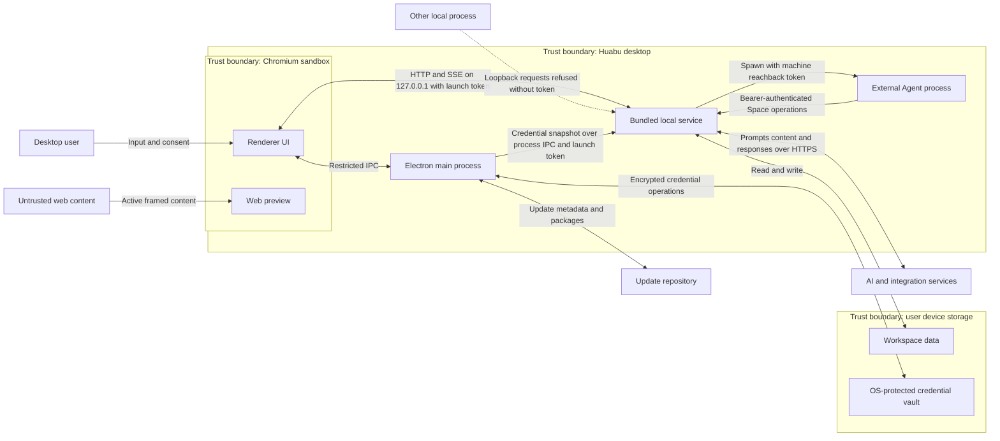

# Huabu Desktop Threat Model

## Scope

This model covers the installed desktop app in its default mode: the app starts its own Server on the same machine and is the only client of it. Connecting the app to a remote Huabu Server (`--server <url>`), and the "Connect device" Agent that mode offers, are not covered.

Every control under [Implemented controls](#implemented-controls) is in the code at the path given beside it. Hardening that is not in the code is listed separately under [Not implemented](#not-implemented) and is not relied on.

## Architecture and data flows

## Implemented controls

| Threat                                    | Potential impact                                                                         | Implemented control                                                                                                                                                                                                            | Code                                                                                                                                                           |
| ----------------------------------------- | ---------------------------------------------------------------------------------------- | ------------------------------------------------------------------------------------------------------------------------------------------------------------------------------------------------------------------------------ | -------------------------------------------------------------------------------------------------------------------------------------------------------------- |
| Unauthorized local API access             | Another program or user on the machine reads or changes Spaces or invokes paid services. | The Server binds to `127.0.0.1`.                                                                                                                                                                                               | `apps/desktop/src/main.ts` (`HUABU_BIND_HOST`)                                                                                                                 |
|                                           |                                                                                          | Each launch creates a random token, held in memory only. The app adds it to requests from its own pages; the Server answers 401 to any other caller.                                                                           | `apps/desktop/src/web-guards.ts`, `apps/server/src/modules/identity/local.ts`                                                                                  |
|                                           | A web page in the user's browser reaches the local API.                                  | Host allowlist against DNS rebinding; Fetch Metadata, Origin and loopback checks on writes; CORS allowlist on reads.                                                                                                           | `apps/server/src/modules/security/host-guard.ts`, `origin-guard.ts`, `cors.ts`                                                                                 |
| Renderer or embedded-content compromise   | Malicious content invokes application capabilities or requests device permissions.       | Every window and Tab runs with the Chromium sandbox, context isolation and Node integration disabled.                                                                                                                          | `apps/desktop/src/main.ts`, `desktop-tabs.ts`                                                                                                                  |
|                                           |                                                                                          | Windows cannot navigate away from the application; other links open in the system browser.                                                                                                                                     | `apps/desktop/src/desktop-tabs.ts` (`guard`)                                                                                                                   |
|                                           |                                                                                          | Privileged IPC channels answer only a main frame of an application window on the application origin.                                                                                                                           | `apps/desktop/src/main.ts` (`assertApplicationSender`), `desktop-tabs.ts`, `updater.ts`, `mac-menu.ts`                                                         |
|                                           |                                                                                          | Device permissions are denied by default. The application's own pages keep clipboard, audio recording and fullscreen; a framed page keeps fullscreen only. Downloads are cancelled unless the file comes from the application. | `apps/desktop/src/web-guards.ts`                                                                                                                               |
|                                           |                                                                                          | Framed web pages are sandboxed `<iframe>`s without `allow-downloads`, and are not given the launch token.                                                                                                                      | `apps/web/src/components/Nodes/web/WebPreview.tsx`, `apps/desktop/src/web-guards.ts`                                                                           |
| Malicious URL fetch                       | The Server is made to fetch a local or private address, or an oversized response.        | Content fetches (web pages, files imported by URL, inlined images, remote PDFs) refuse loopback, private, link-local, carrier-NAT and metadata addresses, checked at connection time on every redirect hop.                    | `apps/server/src/modules/security/outbound.ts`                                                                                                                 |
|                                           |                                                                                          | Fetched bodies stop at a size limit: 20 MB for a page, 50 MB for a file, 4 MB for an inlined image. Page and image fetches have timeouts.                                                                                      | `outbound.ts` (`readBodyWithin`), `preprocessing/loaders/web.loader.ts`, `canvas/import-node-src.ts`, `agent/conversation/prompt/image-inlining.ts`            |
| Credential theft                          | LLM, integration and OAuth credentials are read from disk.                               | Credentials are stored encrypted with the operating system's credential protection and handed to the Server over process IPC.                                                                                                  | `apps/desktop/src/secure-secrets.ts`, `apps/server/src/security/desktop-secret-bridge.ts`                                                                      |
| Prompt injection and unsafe Agent actions | An Agent misled by untrusted content changes a Space in ways the user did not intend.    | Agent writes are validated against a fixed command schema, refused when the node was not read or has since changed, always recorded as made by an Agent, and shown in the conversation as changes the user can revert.         | `packages/shared/src/types/api/space-operations.ts`, `apps/server/src/modules/canvas/canvas-executor.ts`, `apps/server/src/modules/remote_fs/space-execute.ts` |
| External Agent token theft                | An Agent inherits the Server's configuration or secrets.                                 | `HUABU_*` variables are removed from an Agent's environment; reachback is injected explicitly and requires a random bearer token.                                                                                              | `apps/server/src/app.ts` (`hostEnvPrefix`), `packages/client-runtime/src/bootstrap.ts`, `apps/server/src/connection-token.ts`                                  |
|                                           | An Agent reads files outside the Space through the reachback API.                        | Reachback paths are resolved inside the Space and traversal is refused.                                                                                                                                                        | `apps/server/src/modules/remote_fs/node-meta.ts`, `apps/server/src/modules/agent/tools/handlers/fs-sandbox.ts` (`safeResolve`)                                 |
| Update supply-chain compromise            | A substituted package executes with application privileges.                              | Updates come from the GitHub release feed over HTTPS with SHA-512 metadata, and are downloaded and installed only when the user asks.                                                                                          | `apps/desktop/src/updater.ts`, `apps/desktop/electron-builder.yml`                                                                                             |
|                                           |                                                                                          | macOS builds use the hardened runtime and are signed and notarized. The Windows installer is Authenticode-signed through ESRP.                                                                                                 | `apps/desktop/electron-builder.yml`, `azure-pipelines.yml`                                                                                                     |
|                                           |                                                                                          | The installed Windows app accepts an update only if its Authenticode signer is `Microsoft Corporation`. The release pipeline fails if the ESRP signer is anyone else, so a release that could not update is never published.   | `apps/desktop/electron-builder.yml` (`publisherName`), `apps/desktop/scripts/esrp-release.mjs`, `azure-pipelines.yml`                                          |

## Not implemented

These are known gaps. None is counted as a mitigation above.

| Threat                                    | Gap                                                                                                                                                                                                                                                              | Status                                                               |
| ----------------------------------------- | ---------------------------------------------------------------------------------------------------------------------------------------------------------------------------------------------------------------------------------------------------------------- | -------------------------------------------------------------------- |
| Unauthorized local API access             | A program running as the same user with file access can read Workspace files directly and is outside what the launch token can stop.                                                                                                                             | Accepted: outside the application's trust boundary.                  |
| Renderer or embedded-content compromise   | The app removes `X-Frame-Options` and `frame-ancestors` from other sites' responses so they can be framed, and a live page keeps `allow-scripts allow-same-origin`. A framed page is active content and can imitate application UI inside its frame.             | Open. Replacing live previews with inert content is not planned yet. |
| Malicious URL fetch                       | Behind `HTTP(S)_PROXY` the proxy makes the connection, so each hop is checked before it is sent rather than at connection time.                                                                                                                                  | Accepted: residual DNS-rebinding window in proxied networks.         |
|                                           | A live web preview, and an image node whose source is a remote URL, load in the renderer rather than through the Server, so they can request a private address. The Server and Agents cannot read the response.                                                  | Open.                                                                |
|                                           | A remote PDF fetch has a size limit but no timeout.                                                                                                                                                                                                              | Open.                                                                |
| Prompt injection and unsafe Agent actions | External content is not marked as untrusted in prompts, tools are not granted per task, and an external Agent's permission request is approved automatically when no UI is attached.                                                                             | Planned, not scheduled.                                              |
| Untrusted external Agent execution        | An external Agent runs as the user, without a sandbox, and inherits every environment variable except `HUABU_*`.                                                                                                                                                 | Planned, not scheduled.                                              |
| External Agent token theft                | The reachback token grants every Space and does not expire.                                                                                                                                                                                                      | Planned, not scheduled.                                              |
| Update supply-chain compromise            | Binaries inside the Windows installer are unsigned, downgrade prevention is not configured explicitly, and the step that copies pipeline output to the GitHub release is outside this repository, so nothing here prevents a released asset from being replaced. | Planned, not scheduled.                                              |

## Sensitive assets

- Workspace content, artifacts, memory, history, and settings.
- LLM, integration, and OAuth credentials.
- Agent instructions, responses, tools, and reachback bearer tokens.
- Desktop packages, update metadata, logs, and crash diagnostics.

## Entra permissions

The reviewed desktop application does not request Microsoft Entra tenant permissions or Microsoft Graph permissions. If such permissions are introduced, the exact delegated or application permissions, accessed data, consent requirements, and token flow must be added to this model before tenant review.
