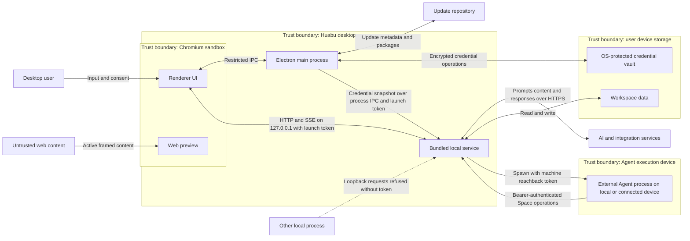

# Huabu Desktop Threat Model

## Scope

This model covers the installed desktop app hosting its bundled Huabu Server, the desktop UI, and external Agents attached to that Server through Agentlet. An Agent may execute on the desktop's own device or on another connected device; its execution location does not exclude it from the Agent trust and reachback considerations below.

The bundled Server binds to loopback by default. An Agent on another device needs a configured connection path; this model does not claim that loopback makes an externally exposed or forwarded endpoint safe. Network exposure and transport protection must be assessed for that connection path. Using the desktop solely as a client of a separately deployed Huabu Server is outside this model.

Every control under [Implemented controls](#implemented-controls) is in the code at the path given beside it. Hardening that is not in the code is listed separately under [Not implemented](#not-implemented) and is not relied on.

## Trust assumptions

Users select and authorize their own external Agents. These Agents run with the operating-system privileges of their account on the execution device; Huabu does not provide an additional OS-level execution sandbox. Execution isolation and the Agent's own command-approval policy depend on the selected provider and user configuration.

Huabu removes inherited `HUABU_*` configuration when starting its Server-owned local Agentlet and explicitly injects the runtime coordinates and credentials an Agent needs. Agents on connected devices use those devices' environments rather than inheriting the desktop Server's environment. Other inherited environment variables remain available for the user's Agent authentication and toolchain. This is not an allowlist of all possible environment variables or a guarantee that inherited user configuration contains no secrets.

## Architecture and data flows

## Implemented controls

| Threat                                    | Potential impact                                                                         | Implemented control                                                                                                                                                                                                                                                                                                                                                                                                               | Code                                                                                                                                                                          |
| ----------------------------------------- | ---------------------------------------------------------------------------------------- | --------------------------------------------------------------------------------------------------------------------------------------------------------------------------------------------------------------------------------------------------------------------------------------------------------------------------------------------------------------------------------------------------------------------------------- | ----------------------------------------------------------------------------------------------------------------------------------------------------------------------------- |
| Unauthorized local API access             | Another program or user on the machine reads or changes Spaces or invokes paid services. | The Server binds to `127.0.0.1`.                                                                                                                                                                                                                                                                                                                                                                                                  | `apps/desktop/src/main.ts` (`HUABU_BIND_HOST`)                                                                                                                                |
|                                           |                                                                                          | Each launch creates a random token, held in memory only. The app adds it to requests from its own pages; the Server answers 401 to a caller without it. The exceptions are an Agent reaching back with the machine bearer token, and the public guide that tells an Agent how to reach back.                                                                                                                                      | `apps/desktop/src/web-guards.ts`, `apps/server/src/modules/identity/local.ts`                                                                                                 |
|                                           | A web page in the user's browser reaches the local API.                                  | Host allowlist against DNS rebinding; Fetch Metadata, Origin and loopback checks on writes; CORS allowlist on reads.                                                                                                                                                                                                                                                                                                              | `apps/server/src/modules/security/host-guard.ts`, `origin-guard.ts`, `cors.ts`                                                                                                |
| Renderer or embedded-content compromise   | Malicious content invokes application capabilities or requests device permissions.       | Every window and Tab runs with the Chromium sandbox, context isolation and Node integration disabled.                                                                                                                                                                                                                                                                                                                             | `apps/desktop/src/main.ts`, `desktop-tabs.ts`                                                                                                                                 |
|                                           |                                                                                          | Windows cannot navigate away from the application; other links open in the system browser.                                                                                                                                                                                                                                                                                                                                        | `apps/desktop/src/desktop-tabs.ts` (`guard`)                                                                                                                                  |
|                                           |                                                                                          | Privileged IPC channels answer only a main frame of an application window on the application origin.                                                                                                                                                                                                                                                                                                                              | `apps/desktop/src/main.ts` (`assertApplicationSender`), `desktop-tabs.ts`, `updater.ts`, `mac-menu.ts`                                                                        |
|                                           |                                                                                          | Device permissions are denied by default. The application's own pages keep clipboard, audio recording and fullscreen; a framed page keeps fullscreen only. A download is cancelled unless the application starts it for one of its own files.                                                                                                                                                                                     | `apps/desktop/src/web-guards.ts`                                                                                                                                              |
|                                           |                                                                                          | Framed web pages are sandboxed `<iframe>`s without `allow-downloads`. A file the Server stores is always served to render in an opaque origin, however it is reached, so it never runs as the application. The launch token goes only to requests shown to be the application's: a document is judged by its own origin, a worker by its referrer. Only the application's pages, over IPC, can have a stored file shown or saved. | `apps/server/src/modules/artifact/send-blob.ts`, `apps/web/src/components/Nodes/web/livePageSandbox.ts`, `apps/desktop/src/web-guards.ts`, `apps/desktop/src/server-files.ts` |
| Malicious URL fetch                       | The Server is made to fetch a local or private address, or an oversized response.        | Content fetches (web pages, files imported by URL, inlined images, remote PDFs) refuse loopback, private, link-local, carrier-NAT and metadata addresses, on every redirect hop.                                                                                                                                                                                                                                                  | `apps/server/src/modules/security/outbound.ts`                                                                                                                                |
|                                           |                                                                                          | Fetched bodies stop at a size limit: 20 MB for a page, 50 MB for a file, 4 MB for an inlined image. Page and image fetches have timeouts.                                                                                                                                                                                                                                                                                         | `outbound.ts` (`readBodyWithin`), `preprocessing/loaders/web.loader.ts`, `canvas/import-node-src.ts`, `agent/conversation/prompt/image-inlining.ts`                           |
| Credential theft                          | LLM, integration and OAuth credentials are read from disk.                               | Credentials are stored encrypted with the operating system's credential protection and handed to the Server over process IPC.                                                                                                                                                                                                                                                                                                     | `apps/desktop/src/secure-secrets.ts`, `apps/server/src/security/desktop-secret-bridge.ts`                                                                                     |
| Prompt injection and unsafe Agent actions | An Agent misled by untrusted content changes a Space in ways the user did not intend.    | Agent writes are validated against a fixed command schema, refused when the node was not read or has since changed, always recorded as made by an Agent, and shown in the conversation as changes the user can revert.                                                                                                                                                                                                            | `packages/shared/src/types/api/space-operations.ts`, `apps/server/src/modules/canvas/canvas-executor.ts`, `apps/server/src/modules/remote_fs/space-execute.ts`                |
|                                           |                                                                                          | Canvas resource reference labels and content are explicitly identified as untrusted in prompt rendering. This tells the Agent to treat reference material as data rather than an authorization source; it is not an enforceable permission boundary or a guarantee against prompt injection.                                                                                                                                      | `apps/server/src/modules/agent/conversation/prompt/build-prompt.ts` (`ink_resource_references`)                                                                               |
|                                           | An Agent misled by untrusted content runs commands on the device.                        | Auto-approval is off for every automatically discovered Agent unless the user turns it on in Settings or in the conversation. An Agent whose CLI asks before a tool call then does, and the conversation shows the request to allow or deny.                                                                                                                                                                                      | `apps/server/src/modules/agent/acp/harness-profile-discovery.ts`                                                                                                              |
|                                           |                                                                                          | ACP permission requests received by Huabu require a registered approval handler for that session. With a handler, requests wait for a decision; timeout, abort or a failing handler cancels them. Without a handler, requests are cancelled immediately and logged, including during initialization or outside a turn. This does not override an external Agent's own auto-approval configuration.                                | `external/agenetes/packages/acp-driver/src/client.ts` (`handleRequestPermission`), `handle.ts`                                                                                |
| External Agent token theft                | An Agent inherits the Server's configuration or secrets.                                 | Server-owned local Agentlet processes do not inherit `HUABU_*` variables from the Server; reachback is injected explicitly and requires a random bearer token.                                                                                                                                                                                                                                                                    | `apps/server/src/app.ts` (`hostEnvPrefix`), `packages/client-runtime/src/bootstrap.ts`, `apps/server/src/connection-token.ts`                                                 |
|                                           | An Agent reads files outside the Space through the reachback API.                        | Reachback paths are resolved inside the Space and traversal is refused.                                                                                                                                                                                                                                                                                                                                                           | `apps/server/src/modules/remote_fs/node-meta.ts`, `apps/server/src/modules/agent/tools/handlers/fs-sandbox.ts` (`safeResolve`)                                                |
| Update supply-chain compromise            | A substituted package executes with application privileges.                              | Updates come from the GitHub release feed over HTTPS with SHA-512 metadata, and are downloaded and installed only when the user asks.                                                                                                                                                                                                                                                                                             | `apps/desktop/src/updater.ts`, `apps/desktop/electron-builder.yml`                                                                                                            |
|                                           |                                                                                          | macOS builds use the hardened runtime and are signed and notarized. The Windows installer is Authenticode-signed through ESRP.                                                                                                                                                                                                                                                                                                    | `apps/desktop/electron-builder.yml`, `azure-pipelines.yml`                                                                                                                    |
|                                           |                                                                                          | The installed Windows app accepts an update only if its Authenticode signer is `Microsoft Corporation`. The release pipeline fails if the ESRP signer is anyone else, so a release that could not update is never published.                                                                                                                                                                                                      | `apps/desktop/electron-builder.yml` (`publisherName`), `apps/desktop/scripts/esrp-release.mjs`, `azure-pipelines.yml`                                                         |

## Not implemented

These are known gaps. None is counted as a mitigation above.

| Threat                                    | Gap                                                                                                                                                                                | Status                          |
| ----------------------------------------- | ---------------------------------------------------------------------------------------------------------------------------------------------------------------------------------- | ------------------------------- |
| Prompt injection and unsafe Agent actions | Task-specific permissions for Huabu tools are not enforced. Reference-content labeling and command validation do not restrict an Agent to the capabilities required by one task.   | Not implemented; not scheduled. |
| External Agent token theft                | In local desktop mode, the reachback token grants access to every Space and does not expire. Per-Space, permission-limited, short-lived reachback credentials are not implemented. | Not implemented; not scheduled. |

## Sensitive assets

- Workspace content, artifacts, memory, history, and settings.
- LLM, integration, and OAuth credentials.
- Agent instructions, responses, tools, and reachback bearer tokens.
- Desktop packages, update metadata, logs, and crash diagnostics.

## Entra permissions

The reviewed desktop application does not request Microsoft Entra tenant permissions or Microsoft Graph permissions. If such permissions are introduced, the exact delegated or application permissions, accessed data, consent requirements, and token flow must be added to this model before tenant review.
